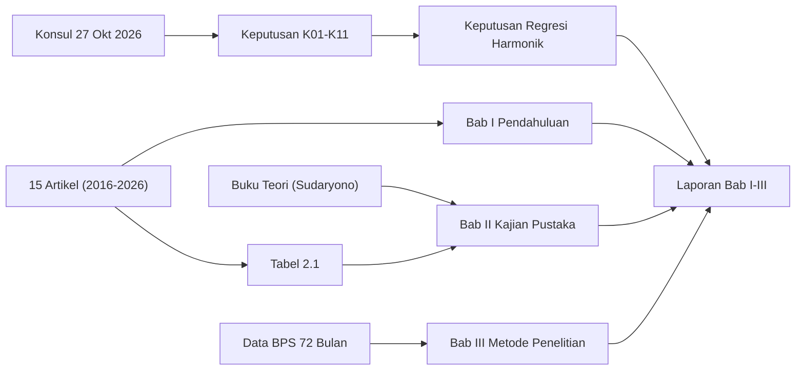

# Peta Proyek: Curah Hujan Kota Mataram dengan Regresi Harmonik

Tugas Statistika Kelompok 3 Program Studi S1 Ilmu Komputer, Universitas Bumigora. Laporan berhenti pada Bab III sesuai arahan dosen pengampu.

## Alur Proyek

## Peta Navigasi Vault
- **Riwayat apa saja yang sudah dikerjakan:** [[Riwayat Pekerjaan]]
- **Progres terbaru:** [[Catatan Progres 31 Okt 2026]]
- **Skrip build:** folder `build/` ([[README]]): `buat_xlsx.py` dan `buat_docx.py`
- **Aturan kerja:** [[Aturan Kerja]] (jangan build ulang jika tidak disuruh)
- **Konsultasi Dosen:** [[Konsul 27 Okt 2026]] (14 catatan keputusan dosen, seluruhnya terintegrasi)
- **Naskah Laporan:** [[Status Laporan Revisi]], [[Abstrak dan Kata Pengantar]], [[Bab I Pendahuluan]], [[Bab II Kajian Pustaka]], [[Bab III Metode Penelitian]], [[Daftar Pustaka]], [[Lampiran]]
- **Kerangka Pemikiran:** [[Gambar 2.1 Kerangka Pemikiran]] (diadaptasi dari alur Kusdarwati 2023 dan Purnama 2021)
- **Artikel Terkait:** [[Tabel 2.1 Penelitian Terdahulu]] (15 artikel 2016–2026), [[Artikel Tidak Dipakai]]
- **Buku Teori:** [[Sudaryono 2021]], [[Rujukan Lain]]; dilepas: [[Wilks 2019]]
- **Data & Analisis:** [[Data BPS 72 Bulan]], [[Revisi BPS 2024]], [[Catatan Kualitas Data]]
- **Metode Analisis:** [[Alur Regresi Harmonik]] (4 langkah: matriks, statistik deskriptif, sin/cos + OLS + uji F, ramalan 2025)
- **Status & Panduan:** [[Daftar Tugas]], [[Log Verifikasi]], [[Pertanyaan Terbuka]]
- **Tim:** [[Anggota Kelompok]]
- **Panduan Pemahaman Mahasiswa (Bahasa Manusia):** [[00 Mulai Di Sini]] (folder `Panduan/`)
- **Berkas & Aset:** [[Berkas]]
- **Revisi berikutnya (belum dikerjakan):** [[Revisi Berikutnya]]

## Angka Kunci Penelitian (Data dan Rancangan)
- **Periode Data:** n = 72 bulan (Januari 2020 – Desember 2025). Pembagian: 60 bulan data latih (2020–2024), 12 bulan data uji (2025).
- **Statistik Deskriptif:** Mean 174,80 mm, Median 173,70 mm, Modus 0,00 mm, Simpangan Baku Sampel 135,35 mm.
- **Model:** Regresi Harmonik orde k=1 (periode T = 12 bulan), $Y_t = b_0 + b_1 \sin(2\pi t/12) + b_2 \cos(2\pi t/12) + \varepsilon_t$, estimasi OLS.
- **Evaluasi yang direncanakan:** RMSE dan MAE pada data uji 2025 terhadap ramalan sederhana.
