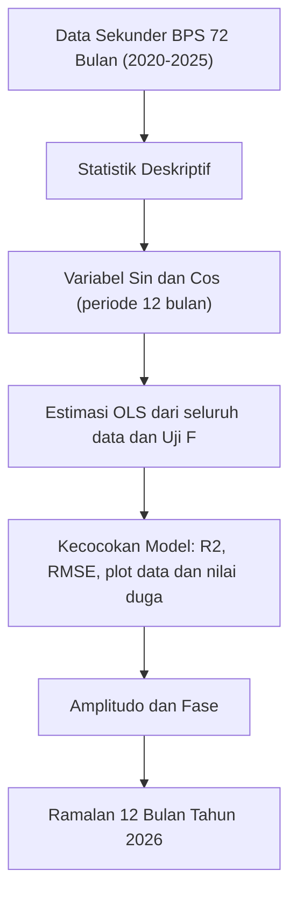

# Gambar 2.1 Kerangka Pemikiran

Alur konseptual pemodelan regresi harmonik univariat. Versi gambar di PDF dibuat ulang oleh `build/buat_docx.py` dengan alur yang sama dalam 5 kotak: data 72 bulan; statistik deskriptif; sin/cos, OLS, dan uji F; R² dan RMSE; ramalan 2026. Diagram di bawah memecah alur itu lebih rinci:

**Keterangan Gambar 2.1:**  
Kerangka pemikiran penelitian peramalan curah hujan bulanan Kota Mataram menggunakan Regresi Harmonik.  
*Sumber:* Diadaptasi dari alur Kusdarwati (2023) dan Astuti dkk. (2018).

Sumber adaptasi diganti 25 Nov 2026 (sebelumnya Purnama, 2021 dan Kusdarwati, 2023) karena pembagian data latih dan data uji ala Purnama tidak dipakai lagi: [[Keputusan Ramal 2026 dan Dasar Penelitian]].

Terkait: [[Bab II Kajian Pustaka]] (2.7), [[K08 Sumber gambar kerangka pikir]], [[Alur Regresi Harmonik]].
