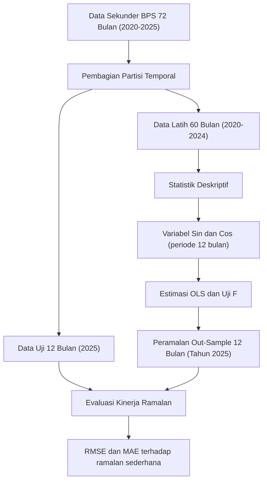

# Gambar 2.1 Kerangka Pemikiran

Alur konseptual pemodelan regresi harmonik univariat. Versi gambar di PDF dibuat ulang oleh `build/buat_docx.py` dengan alur yang sama tetapi lebih ringkas (5 kotak: data; pembagian latih/uji; statistik deskriptif; sin/cos, OLS, dan uji F; ramalan 2025 dengan RMSE dan MAE). Diagram di bawah memecah alur itu lebih rinci:

**Keterangan Gambar 2.1:**  
Kerangka pemikiran penelitian peramalan curah hujan bulanan Kota Mataram menggunakan Regresi Harmonik.  
*Sumber:* Diadaptasi dari alur Purnama (2021) dan Kusdarwati (2023).

Terkait: [[Bab II Kajian Pustaka]] (2.7), [[K08 Sumber gambar kerangka pikir]], [[Alur Regresi Harmonik]].
