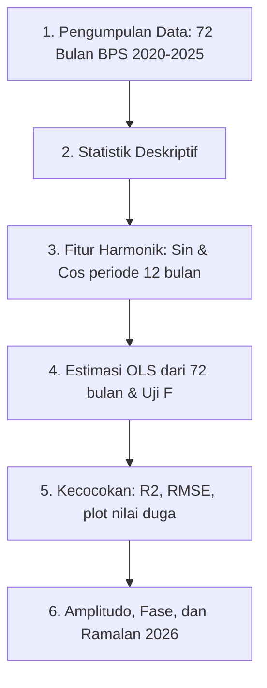

# Alur Regresi Harmonik

Tahapan pemodelan regresi harmonik deret Fourier pada curah hujan bulanan Kota Mataram, diadaptasi dari alur Kusdarwati (2023) dan Astuti dkk. (2018). Seluruh 72 bulan dipakai menyusun model ([[Keputusan Ramal 2026 dan Dasar Penelitian]]).

## Rincian Tahapan
1. **Pengumpulan & Verifikasi Data:** 72 data bulanan dari 6 buku BPS *Kota Mataram dalam Angka*, cek silang rata-rata tahunan.
2. **Statistik Deskriptif:** mean, median, modus, simpangan baku sampel ($n-1$).
3. **Fitur Fourier:** $t = 0, 1, \dots, 71$ (Januari 2020 sampai Desember 2025); $X_{1t} = \sin(2\pi t/12)$ dan $X_{2t} = \cos(2\pi t/12)$.
4. **Estimasi OLS & Uji F:** menaksir $b_0$, $b_1$, $b_2$ dari seluruh 72 bulan; uji F dengan $H_0: b_1 = b_2 = 0$, $\alpha = 0{,}05$, derajat bebas (2, 69).
5. **Kecocokan Model:** $R^2 = 1 - SSE/SST$ dan RMSE pada 72 bulan (Kotarumalos dkk., 2025), serta plot data terhadap nilai duga (Kusdarwati, 2023).
6. **Amplitudo, Fase, dan Ramalan:** amplitudo $A$ dan fase $\phi$ dari $b_1$, $b_2$; ramalan Januari sampai Desember 2026 dengan $t = 72$ sampai $83$. Akurasi ramalan belum bisa diukur karena data aktual 2026 belum terbit.

Dipakai di: [[Bab III Metode Penelitian]] (3.9), [[Gambar 2.1 Kerangka Pemikiran]].
