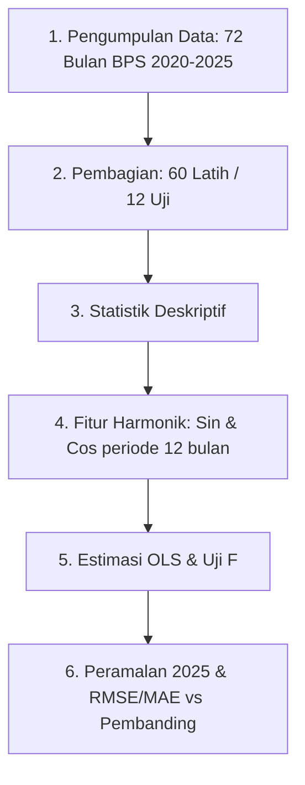

# Alur Regresi Harmonik

Tahapan prosedur pemodelan Regresi Harmonik Deret Fourier pada curah hujan bulanan Kota Mataram (diadaptasi dari alur Kusdarwati 2023 dan Purnama 2021):

## Rincian Tahapan
1. **Pengumpulan & Verifikasi Data:** 72 data bulanan dari 6 buku BPS *Kota Mataram dalam Angka*, cek silang rata-rata tahunan.
2. **Partisi Temporal:** 60 bulan latih (2020–2024) dan 12 bulan uji (2025).
3. **Statistik Deskriptif:** mean, median, modus, simpangan baku sampel ($n-1$).
4. **Fitur Fourier:** $t = 0, 1, \dots, n-1$; $X_{1t} = \sin(2\pi t/12)$ dan $X_{2t} = \cos(2\pi t/12)$.
5. **Estimasi OLS & Uji F:** menaksir $b_0$, $b_1$, $b_2$; uji F dengan $H_0: b_1 = b_2 = 0$, $\alpha = 0{,}05$.
6. **Peramalan & Validasi:** ramalan 12 bulan 2025; RMSE dan MAE terhadap data aktual, dibandingkan dengan ramalan rata-rata data latih dan rata-rata per bulan kalender.

Dipakai di: [[Bab III Metode Penelitian]] (3.9), [[Gambar 2.1 Kerangka Pemikiran]].
